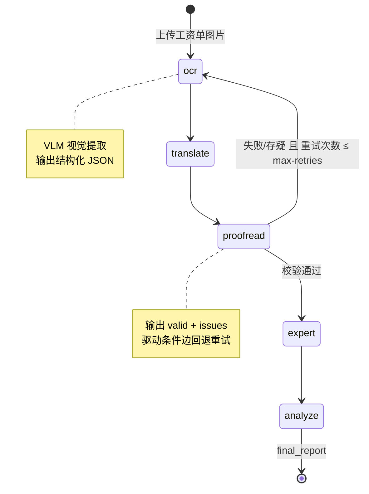
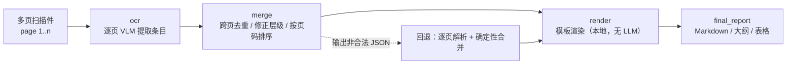
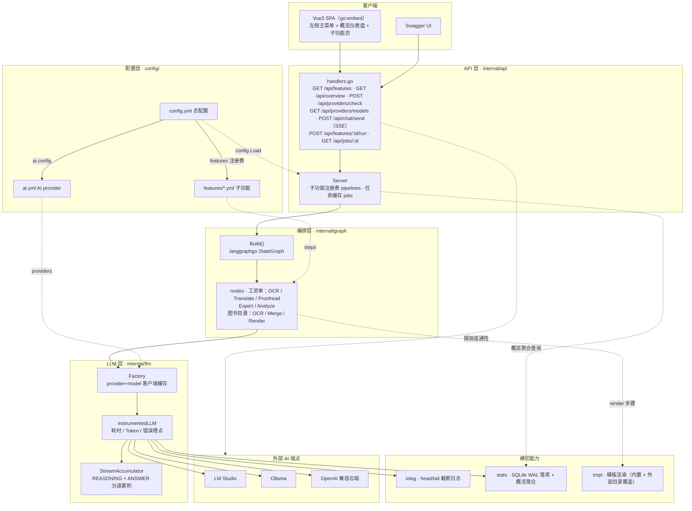
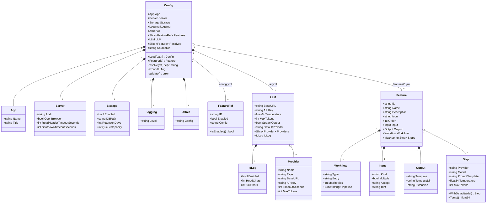
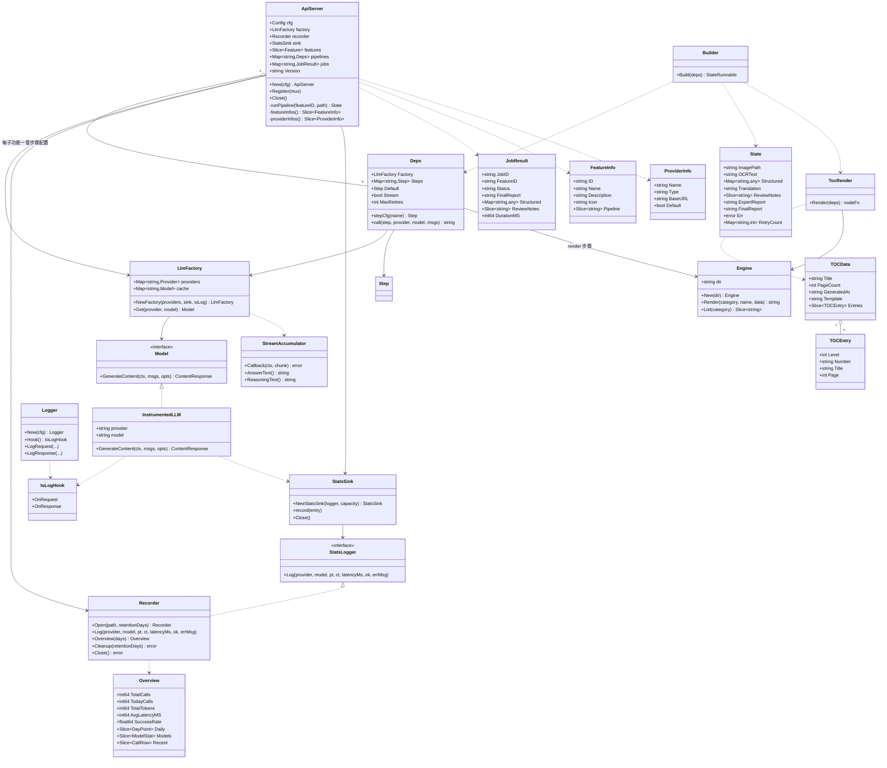

# go-ai-agent

基于 LLM 的通用 AI 工作流平台：以 **可编排的多步骤 LLM 流水线** 为核心，将文档理解、翻译、审读、分析等能力组合成 DAG 工作流，提供 REST API 与开箱即用的 Web UI。

**工资单审读（OCR → 翻译 → 审读 → 专家分析 → 汇总）、图书目录识别（多页 OCR → 跨页合并 → 模板渲染）与 AI 对话（选端点/选模型/流式回复）是平台内置的三个业务场景**；新场景只需「提示词 + 步骤配置 + 模板」即可接入，无需改动编排层。

- **后端**：Go + langchaingo（LLM 调用，OpenAI 兼容协议）+ langgraphgo（工作流编排）+ SQLite（调用统计）
- **API**：REST + OpenAPI 文档（swaggo，`/swagger/index.html`）
- **前端**：Vue3 + TypeScript + Vite（左侧主菜单 + 子功能 + 对话 + 概览仪表盘），构建产物经 `go:embed` 打进单个二进制
- **配置**：三层分离 —— `config.yml`（总配置）/ `ai.yml`（AI provider）/ `features/*.yml`（子功能）
- **部署**：`dist\harness.exe` 双击即用——自动选端口、自动打开浏览器；消息队列与定时任务作为它的子命令（`harness mq` / `harness cron`），不再拆成多个二进制

> 📸 界面截图见 [SCREENSHOT.md](SCREENSHOT.md)（概览仪表盘 / 工资单审读 / 图书目录识别）

## 核心能力

| 能力 | 说明 |
|---|---|
| 多步骤工作流编排 | langgraphgo `StateGraph`，节点间主链 + 条件边（失败/低置信度自动重试） |
| 多 Provider 接入 | LM Studio / Ollama / OpenAI 兼容云端统一为 provider 声明，按 `provider+model` 缓存客户端 |
| 按步骤独立配置 | 每个步骤（节点）独立指定 provider + model + 提示词 + 温度 + max-tokens，模型无全局默认 |
| 子功能可插拔 | 子功能以 `features/*.yml` 声明（输入 + 工作流 + 步骤 + 输出），注册进 `config.yml` 即上菜单，代码零改动 |
| 多页输入 | 支持一次上传多张扫描页（如多页图书目录），逐页依次 OCR 后自动跨页合并 |
| 模板化输出 | 输出经类 FreeMarker 的模板渲染（`internal/tmpl`），内置模板随二进制打包，可用外部目录覆盖 |
| 概览仪表盘 | 侧边栏菜单 + 概览页：调用量/Token/耗时/成功率指标卡、趋势图、模型用量、最近调用 |
| 端点连通性 | 概览页加载时自动探测一次 AI 端点（`GET {base-url}/v1/models`），并支持逐端点/一键手动「测试」；无实时轮询 |
| AI 对话 | 与工作流子功能同级（`kind: chat`）：选择任意 provider、拉取 OpenAI 兼容 `/v1/models` 模型列表、自动探测流式能力并默认 SSE 流式显示回复；视觉模型可选中后上传图片 |
| 视觉（VLM）支持 | `BinaryPart` 多模态输入，任意 OpenAI 兼容视觉模型可直接使用；对话页支持文件选择 / 拖拽 / 粘贴上传图片随消息发送 |
| 思考模型兼容 | 流式接收 + REASONING/ANSWER 分道累积，思考链与回答分别落日志 |
| 全链路可观测 | io-log 截断日志（UUID 关联输入输出）+ SQLite 调用统计（Token/耗时/成功率，保留期自动清理） |
| 零配置运行 | 无参数启动 Web 模式，默认 8000 端口并打开浏览器，端口占用时自动切换随机端口 |

## 快速开始

### 方式一：直接运行（推荐）

```powershell
.\build.ps1          # 构建前端 + 生成 OpenAPI 文档 + 编译单个 harness.exe 到 dist/
cd dist
.\harness.exe        # 无参数：Web 模式，自动挑空闲端口并打开浏览器
```

- Web UI：`http://localhost:8000/`（8000 被占用时自动换随机端口，以控制台打印为准）
- Swagger：`http://localhost:8000/swagger/index.html`

单个二进制按第一个参数分派运行模式：

| 命令 | 模式 |
|---|---|
| `harness` | Web/API 服务（默认，自动选端口 + 打开浏览器） |
| `harness serve [-addr :8000] [-config p] [-no-browser]` | 同上，显式子命令形式 |
| `harness <图片路径> [总配置]` | CLI 单图审读，打印最终报告 |
| `harness mq [-config p]` | 消息队列消费者（骨架） |
| `harness cron [-interval 1h] [-config p]` | 定时任务调度（骨架） |
| `harness version` | 打印版本号（由 `-Version` 注入） |

### 方式二：CLI 单图审读（工资单场景）

```powershell
.\harness.exe .\sample\payslip.png              # 第一参数为图片路径即进入 CLI 模式
.\harness.exe .\payslip.png .\my-config.yml     # 可指定总配置文件
```

### 方式三：前端开发模式

```powershell
cd web
pnpm install
pnpm dev          # http://localhost:5173，/api 已代理到后端 8080

# 另开终端运行后端
cd dist && .\harness.exe -addr :8080 -no-browser
```

## 前置条件

本地或云端任一 OpenAI 兼容 LLM 服务（默认走 LM Studio）：

- **LM Studio**：加载模型（视觉场景需 VLM，如 `qwen3-vl-8b`），开启服务（默认 `http://localhost:1234`）
- **Ollama**：`http://localhost:11434`
- **云端**：硅基流动 / OneAPI / vLLM / OpenAI 官方等，`api-key` 支持 `${OPENAI_API_KEY:默认值}` 环境变量展开

模型名可用环境变量覆盖：`HARNESS_DEFAULT_MODEL=qwen3-vl-8b`

## 配置（三层结构）

```
config/
├── config.yml                  # 总配置：应用/服务/存储/日志 + 子功能注册表
├── ai.yml                      # AI provider：端点列表 + 全局默认（由 config.yml 的 ai.config 引用）
└── features/
    ├── payslip-ocr.yml         # 子功能①：工资单审读（工作流 + 各步骤 provider/model/提示词）
    ├── book-toc.yml            # 子功能②：图书目录识别（多页输入 + 模板输出）
    └── chat.yml                # 子功能③：AI 对话（kind=chat，选端点/选模型/流式回复）
```

| 文件 | 配置节 | 说明 |
|---|---|---|
| `config.yml` | `app` | 应用名与标题（前端侧边栏展示） |
| `config.yml` | `server` | addr（默认 `:8000`，被占用时自动回退随机空闲端口）/ open-browser / 读写超时 |
| `config.yml` | `storage` | SQLite 调用统计：enabled / db-path / retention-days（过期自动清理）/ queue-capacity |
| `config.yml` | `logging.level` | `debug` / `info` / `warn` / `error` |
| `config.yml` | `ai.config` | 指向 `ai.yml`（相对本文件解析） |
| `config.yml` | `features[]` | 子功能注册表：id / enabled / config，**左侧菜单顺序即此列表顺序** |
| `ai.yml` | `llm.providers` | 多后端端点列表（name / type / base-url / api-key / 超时 / max-tokens），未填字段回退全局默认 |
| `ai.yml` | `llm.default-provider` | 步骤未指定 provider 时的回退值；模型无全局默认，各步骤必须显式指定 |
| `ai.yml` | `llm.io-log` | 输入/输出截断日志（head-chars / tail-chars；多模态只记文件名与媒体类型） |
| `ai.yml` | `llm.stream-output` | 统一流式接收（默认开启），关闭回退普通调用 |
| `ai.yml` | `llm.reasoning-enabled` | 思考模式开关，各步骤可独立覆盖 |
| `features/*.yml` | `kind` | 页面类型：`workflow`（默认，上传执行）/ `chat`（对话界面） |
| `features/*.yml` | `chat` | 对话专属配置：default-provider / system-prompt / stream-default / max-history / max-images / max-image-mb |
| `features/*.yml` | `input` | 输入声明：kind / **multiple（多页上传）** / accept / hint，前端据此渲染上传控件 |
| `features/*.yml` | `output` | 输出声明：template（模板名）/ template-dir（外部模板目录，留空用内置）/ extension（下载扩展名） |
| `features/*.yml` | `workflow` | 编排类型 / 入口节点 / max-retries（条件边回退上限）/ pipeline（展示顺序） |
| `features/*.yml` | `steps` | **按步骤独立配置**：provider + model + prompt-template + temperature + max-tokens |

## 添加新子功能

平台与业务解耦，新增子功能只需配置（无需改代码，除非需要新的节点类型）：

1. 新建 `config/features/<id>.yml`：声明 `input`（是否多页）、`workflow`（type/entry/max-retries/pipeline）、
   `steps`（各步骤 provider+model）、`output`（模板名与扩展名）
2. 在 `config.yml` 的 `features[]` 追加 `{ id, enabled, config }`
3. 提示词：`internal/prompt/templates.go` 增加该场景各步骤的系统/用户提示词
4. 节点（仅当现有节点不够用时）：`internal/graph/nodes/` 增加节点函数，签名 `func(ctx, State) (State, error)`，
   并在 `internal/graph/builder.go` 按 `workflow.type` 注册新图（默认分支会报「未知工作流类型」）
5. 模板（如需新格式）：在 `internal/tmpl/templates/<category>/` 增加 `<name>.tpl`

### 子功能一：工资单 OCR 审读（`payslip-ocr`）

上传一张工资单截图，VLM 提取 → 翻译 → 审读校验 → 专家分析 → 汇总报告。



### 子功能二：图书目录识别（`book-toc`）

上传扫描版图书目录页（**支持一次多选多页**），逐页 OCR → 跨页合并校对 → 按模板生成文字版目录。



输出由模板渲染（用法类似 Java FreeMarker），内置三套模板：

| 模板 | 说明 |
|---|---|
| `markdown` | Markdown 列表，层级缩进 + 编号 + 页码（默认） |
| `outline` | 纯文本大纲，编号左对齐、页码右对齐 |
| `table` | Markdown 表格：层级 / 编号 / 标题 / 页码 |

模板语法为 Go `text/template`，可用函数：`repeat`、`indent`、`add`、`sub`、`pad`、`padLeft`、`default`、`trim`、`join`、`upper`、`lower`、`now`。
在 `output.template-dir` 指定目录并放置同名 `.tpl` 即可覆盖内置模板，无需重新编译。

示例（`templates/book-toc/markdown.tpl`）：

```gotemplate
# {{ default "图书目录" .Title }}

> 由 {{ .PageCount }} 页扫描件自动生成 · {{ .GeneratedAt }} · 模板 `{{ .Template }}`

{{ range .Entries -}}
{{ indent (sub .Level 1) }}- {{ if .Number }}{{ .Number }} {{ end }}{{ .Title }}{{ if gt .Page 0 }} — p.{{ .Page }}{{ end }}
{{ end }}
```

### 子功能三：AI 对话（`chat`）

与工资单 OCR / 图书目录同级的可插拔子功能，`kind: chat` 时前端渲染对话界面而非上传执行页：

1. **选择端点**：下拉框列出 `ai.yml` 声明的全部 provider，默认选中 `chat.default-provider`；
2. **选择模型**：切换端点时后端代理 OpenAI 兼容接口 `GET {base-url}/v1/models` 拉取模型列表（可手动刷新重拉）；
3. **流式回复**：选定模型后自动探测端点是否支持流式（发一条 `stream=true` 的最小请求按 SSE 首帧判定），
   支持则默认流式显示（`event: meta/delta/done` SSE 透传，思考增量单独展示），不支持则自动回退普通一次性返回。
4. **Markdown 渲染**：回复经 marked（GFM + 换行即 `<br>`）解析、DOMPurify 消毒后以 HTML 渲染；
   输入区提供「Markdown 渲染」开关，关闭后气泡回退为原始文本（`pre-wrap`），便于核对模型输出的 Markdown 源码。
   开关状态存于 `localStorage`（`go-ai-agent.chat.markdown.v1`），默认开启。
5. **图片输入（视觉模型）**：选中模型被判定为视觉能力（端点元数据 `supported_modalities` 等字段，
   或模型名关键词如 `qwen3-vl`）时，输入区「图片」按钮可用——文件选择对话框、拖拽到消息区、
   或直接粘贴截图三种方式上传；图片以 base64 随 `POST /api/chat/send` 上报，服务端校验类型/数量/体积后
   转为 OpenAI 多模态 `content` 片段（`text` + `image_url` data URL）转发。非视觉模型下按钮禁用并提示原因。
   单条消息最多 `chat.max-images` 张、单张不超过 `chat.max-image-mb` MB；气泡内缩略图可点击看大图。

多轮历史由前端维护并持久化（localStorage），发送时按 `chat.max-history` 裁剪；对话调用同样进 io-log 与 SQLite 统计。
图片的 base64 不写入 localStorage（配额极易溢出）：刷新后历史气泡仅保留文件名标签，该图不再参与后续轮次；
同一会话内（未刷新）图片随历史一起下发，因此可以就同一张图继续追问。
相关接口：`GET /api/providers/models`、`GET /api/providers/stream-check`、`POST /api/chat/send`。

## 架构

### 分层架构图



### 核心类型（类图）

配置模型 —— 三层 yml 与 Go 结构体的对应关系：



运行时核心类型 —— API / 编排 / LLM / 统计的依赖关系：



### 目录结构

```
├── cmd/
│   └── harness/          # 唯一入口：main.go（模式分派）/ web.go / cli.go / mq.go / cron.go
├── api/                  # swag 生成的 OpenAPI 文档（docs.go + swagger.json/yaml）
├── internal/
│   ├── api/              # REST 服务 + Swagger 注解 + 内嵌前端（webdist/）
│   ├── config/           # config.yml → ai.yml → features/*.yml 三层加载（含 ${ENV:default}、启动期校验）
│   ├── llm/              # 工厂、流式累积器、统计埋点包装
│   ├── graph/            # StateGraph 组装 + 条件边重试（工作流编排层）
│   │   └── nodes/        # 业务节点 + State 定义
│   ├── prompt/           # 各步骤提示词模板
│   ├── stats/            # SQLite 落库 + 保留期清理 + 概览聚合
│   └── tmpl/             # 模板渲染引擎 + 内置模板（templates/book-toc/*.tpl）
├── pkg/
│   └── iolog/            # head/tail 截断日志（可复用基础库）
├── web/                  # Vue3 + TS + Vite 前端
│   └── src/
│       ├── components/   # Sidebar / MetricCard / Sparkline / TrendChart / AppIcon
│       ├── views/        # OverviewView（概览仪表盘）/ FeatureView（子功能执行页）/ ChatView（对话）
│       ├── api.ts        # REST 封装     types.ts  # 接口类型     chart.ts  # 图表计算
│       └── styles.css    # 全局主题（浅色卡片式，绿/蓝/紫/橙强调色）
├── docs/                 # 人工文档（screenshot/ 截图、tasks/ 任务笔记）
├── config/
│   ├── config.yml        # 总配置（入口）
│   ├── ai.yml            # AI provider 端点
│   └── features/         # 各子功能配置（payslip-ocr.yml / book-toc.yml / chat.yml）
└── build.ps1             # 一键构建（swag → pnpm → go → dist/，产出单个 harness.exe）
```

## API 摘要

| 方法 | 路径 | 说明 |
|---|---|---|
| GET | `/api/features` | 子功能清单（前端左侧菜单 + 流程链）+ provider 列表 |
| GET | `/api/overview?days=14` | 概览指标：总量/今日/耗时/成功率/按天趋势/模型用量/最近调用 |
| POST | `/api/providers/check` | 测试 AI 端点连通性；body `{"provider":"name"}` 只测指定端点，省略则并发测试全部端点 |
| GET | `/api/providers/models?provider=` | 代理 OpenAI 兼容 `GET /v1/models` 拉取模型列表（对话子功能选模型用） |
| GET | `/api/providers/stream-check?provider=&model=` | 探测指定端点+模型是否支持流式（SSE）返回 |
| POST | `/api/chat/send` | 发送对话消息：默认 SSE 流式下发（事件 `meta`/`delta`/`done`/`error`），`stream:false` 时一次性 JSON 返回；`messages[].images`（base64）随消息上传图片 |
| POST | `/api/features/{id}/run` | multipart 上传并执行子功能工作流：单文件用 `file` 字段，多页用 `files` 字段（可多个，按上传顺序处理） |
| POST | `/api/payslip/review` | 工资单场景快捷入口（等价于 `features/payslip-ocr/run`） |
| GET | `/api/jobs/{id}` | 按任务 ID 查询结果（预留异步扩展） |
| GET | `/api/health` | 健康检查 |
| GET | `/swagger/index.html` | OpenAPI 交互文档 |

执行结果字段：`status`、`final_report`（汇总报告）、`structured`（结构化字段）、`ocr_text`、`translation`、`review_notes`（审读问题）、`duration_ms`。

## 构建（build.ps1）

```powershell
.\build.ps1                  # 完整流程：测试 → swag → pnpm build → 嵌入 → 编译
.\build.ps1 -SkipTests       # 跳过 go test
.\build.ps1 -Version v1.0.0  # 注入版本号（harness version 与启动横幅可见）
```

产物为自包含的 `dist/`：`harness.exe + config/`，前端已嵌入 `harness.exe`；`database/` 首次运行自动创建。
构建时会清理 `dist/` 下不再产出的旧二进制（如早期拆分出的 `api.exe`/`mq.exe`/`cron.exe`），避免误启动旧版本。

## 常见问题

| 问题 | 处理 |
|---|---|
| 思考型模型（qwen3）返回空内容 | yml 里把 `max-tokens` 提到 8192，或设 `reasoning-enabled: false` |
| LM Studio 404 | `base-url` 不要带 `/v1`，langchaingo 自动追加 |
| Ollama 报 unknown field | 需兼容旧 `max_tokens` 字段的后端叠加 legacy 选项 |
| 端口被占用 | 默认 8000；被占用时自动切换随机端口，以控制台打印的地址为准（`-addr :9000` 可指定） |
| 想换模型 | 改 `config/features/*.yml` 对应步骤的 `provider` + `model`，或设环境变量 `HARNESS_DEFAULT_MODEL` 兜底 |
| 想换目录输出格式 | 改 `book-toc.yml` 的 `output.template`（`markdown` / `outline` / `table`），或用 `output.template-dir` 指向自己的 `.tpl` 目录 |
| 目录识别少条目 | 提高扫描清晰度并一次上传所有目录页；合并步骤失败时会自动回退为「逐页合并」，结果页会给出提示 |
| 找不到配置文件 | 总配置默认是 `config/config.yml`，可用 `-config` 指定；文件内的引用路径按「相对该文件」解析 |
| 端点显示「无法连接」 | 确认 LM Studio / Ollama 已启动并开启 OpenAI 兼容服务；探测走 `GET {base-url}/v1/models` |
| 端点显示「鉴权失败」 | 端点可达但 API Key 被拒：检查 `ai.yml` 的 `api-key`（支持 `${OPENAI_API_KEY:默认值}`） |
