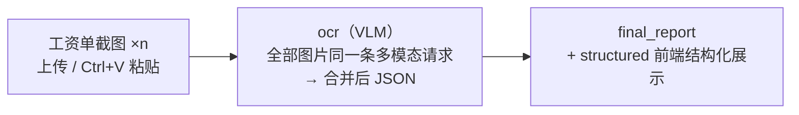
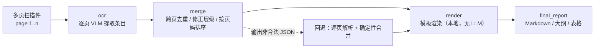
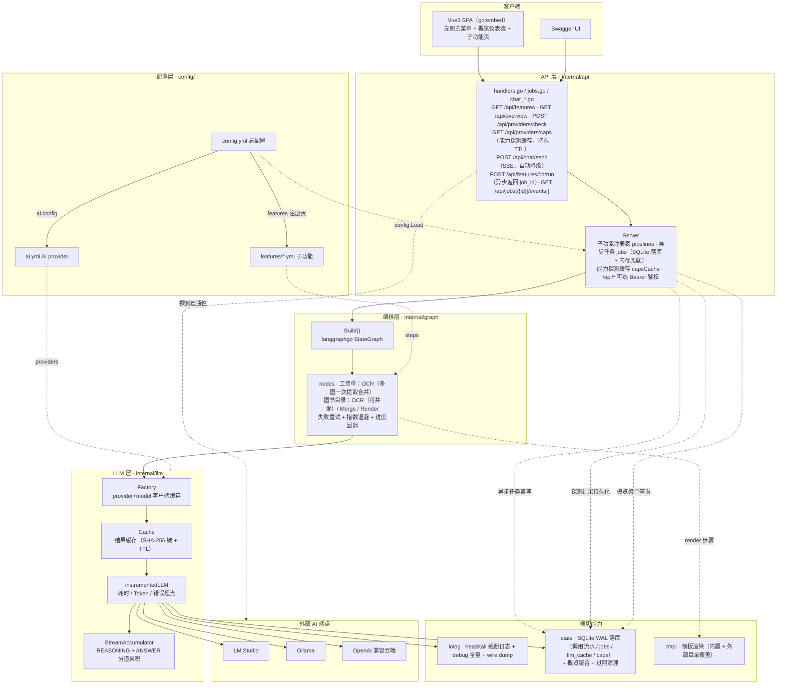
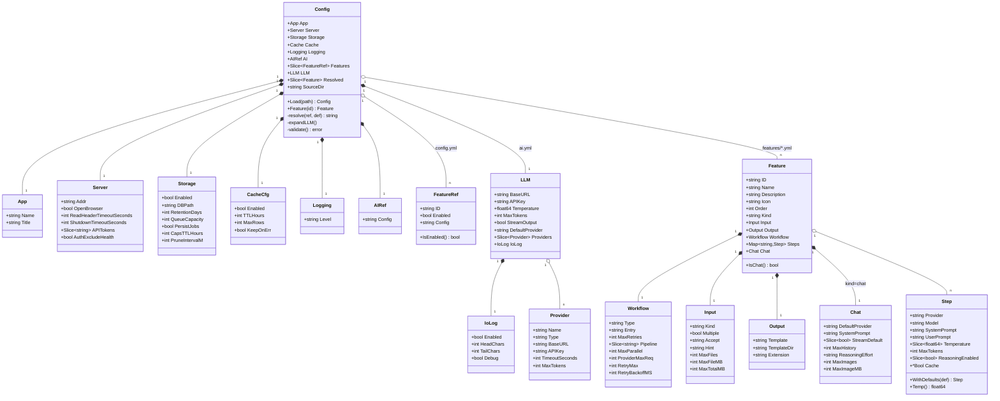
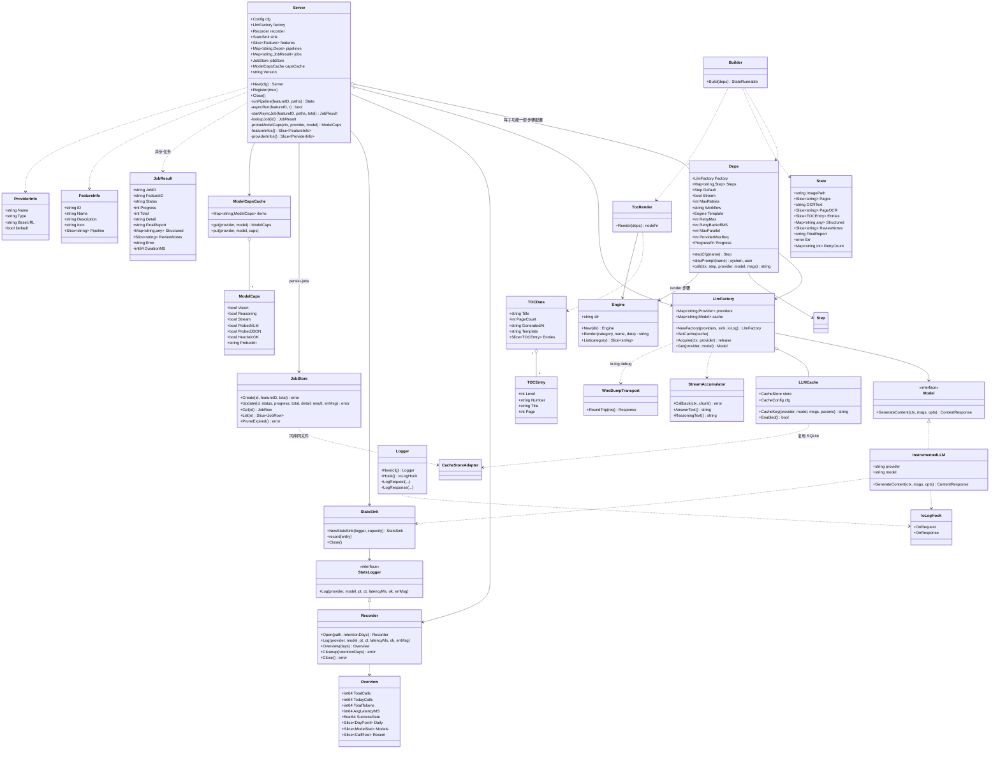

# go-ai-agent

基于 LLM 的通用 AI 工作流平台：以 **可编排的多步骤 LLM 流水线** 为核心，将文档理解、信息提取、翻译、审读、分析等能力组合成 DAG 工作流，提供 REST API 与开箱即用的 Web UI。

**AI聊天（选端点/选模型/能力探测/流式回复/视觉模型图片输入）、工资单解析（多张截图 → VLM 一次提取并合并为结构化 JSON）与图书目录识别（多页 OCR → 跨页合并 → 模板渲染）是平台内置的三个业务场景**；新场景只需「提示词 + 步骤配置 + 模板」即可接入，编排层代码基本零改动。

- **后端**：Go + langchaingo（LLM 调用，OpenAI 兼容协议）+ langgraphgo（工作流编排）+ SQLite（调用统计）
- **API**：REST + OpenAPI 文档（swaggo，`/swagger/index.html`）
- **前端**：Vue3 + TypeScript + Vite（左侧主菜单 + 子功能 + 对话 + 概览仪表盘），构建产物经 `go:embed` 打进单个二进制，源码与文档见 [web/README.md](web/README.md)
- **配置**：三层分离 —— `config.yml`（总配置）/ `ai.yml`（AI provider）/ `features/*.yml`（子功能）
- **部署**：`dist\harness.exe` 双击即用——自动选端口、自动打开浏览器；消息队列与定时任务作为它的子命令（`harness mq` / `harness cron`），不再拆成多个二进制
- **可靠性**：工作流默认异步任务执行（立即返回 `job_id`，SSE/轮询查看「第 n/m 页」进度，重启后仍可查）、单次调用失败自动指数退避重试、相同输入命中 LLM 结果缓存不再重复请求

> 📸 界面截图见 [SCREENSHOT.md](SCREENSHOT.md)（概览仪表盘 / 工资单解析 / 图书目录识别 / AI聊天；工资单截图仍为早期五步流水线版本）

## 核心能力

| 能力 | 说明 |
|---|---|
| 多步骤工作流编排 | langgraphgo `StateGraph`，节点间主链 + 条件边（失败/低置信度自动重试） |
| 多 Provider 接入 | LM Studio / Ollama / OpenAI 兼容云端统一为 provider 声明，按 `provider+model` 缓存客户端 |
| 按步骤独立配置 | 每个步骤（节点）独立指定 provider + model + 温度 + max-tokens，模型无全局默认 |
| 提示词配置化 | 各步骤 system-prompt / user-prompt 直接写在 `features/*.yml`，改提示词无需重新编译；缺失启动期校验报错 |
| 模型能力探测 | 视觉 / 推理 / 流式能力真实调用探测并按 provider+model 缓存（`GET /api/providers/caps`），探测失败回退端点元数据 + 模型名启发式 |
| 子功能可插拔 | 子功能以 `features/*.yml` 声明（输入 + 工作流 + 步骤 + 输出），注册进 `config.yml` 即上菜单，代码零改动 |
| 异步任务与进度 | `storage.persist-jobs` 开启后上传立即返回 `job_id` 后台执行，SSE（`/api/jobs/{id}/events`）或轮询查看「第 n/m 页」进度，任务落 SQLite、重启后仍可查 |
| LLM 结果缓存 | 相同 provider+模型+消息+参数 命中缓存即不再请求端点（SHA-256 键，多模态图片按内容摘要参与哈希；TTL + LRU 行数上限淘汰），OCR/提取类确定性任务收益最大；步骤可用 `cache: false` 单独绕过 |
| 失败重试与限流 | 单次调用失败自动重试（仅限流/5xx/网络错误，指数退避 + 抖动；端点给出 `Retry-After` 时优先遵循），逐页 OCR 可并发（`max-parallel`），每 provider 并发上限（`provider-max-requests`） |
| 上传强校验 | 输入声明 `max-files` / `max-file-mb` / `max-total-mb`，前端提示 + 服务端按上限拒绝 |
| API 鉴权（可选） | `server.api-tokens` 配置令牌后仅保护 `/api/*`（`Authorization: Bearer` 或 `X-API-Key`，常数时间比对），前端页面不受影响，默认不鉴权 |
| 默认只绑回环 + 安全响应头 | 默认监听 `127.0.0.1:8000`（需局域网访问时改 `server.addr`）；前端页面下发 CSP / `X-Content-Type-Options` / `Referrer-Policy`；wire dump 中的 `Authorization`/`api-key` 等凭据头一律脱敏 |
| 接口文档开关 | `server.swagger-enabled: false` 关闭 `/swagger`（暴露到非可信网络时建议关闭） |
| 多页/多图输入 | 支持一次上传多张扫描页或多张工资单截图（也可 Ctrl+V 粘贴），工资单多图一次请求提取并合并、目录逐页 OCR 后跨页合并 |
| 模板化输出 | 输出经类 FreeMarker 的模板渲染（`internal/tmpl`），内置模板随二进制打包，可用外部目录覆盖 |
| 概览仪表盘 | 侧边栏菜单 + 概览页：调用量/Token/耗时/成功率指标卡、趋势图、模型用量、最近调用 |
| 端点连通性 | 概览页加载时自动探测一次 AI 端点（`GET {base-url}/v1/models`），并支持逐端点/一键手动「测试」；无实时轮询 |
| AI聊天 | 与工作流子功能同级（`kind: chat`）：选择任意端点、拉取 OpenAI 兼容 `/v1/models` 模型列表，流式默认开启、调用时自动检测端点支持并降级；回复气泡标注本次端点/模型/token 用量 |
| 视觉（VLM）支持 | 多模态输入统一构造标准 OpenAI `image_url` data URL（绕开 langchaingo BinaryPart 私有序列化），发送前按内容识别真实 MIME、超长边自动缩放；对话页图片可文件选择 / 拖拽 / 粘贴上传 |
| 思考模型兼容 | 流式接收 + REASONING/ANSWER 分道累积，思考链与回答分别落日志；`chat.reasoning-effort` 可控制思考力度 |
| 全链路可观测 | io-log 截断日志（UUID 关联输入输出）+ SQLite 调用统计（Token/耗时/成功率，保留期自动清理）；`io-log.debug` 输出完整原文并开启 HTTP 层 wire dump（原始请求/响应报文，base64 只记长度、`Authorization`/`api-key` 等凭据头脱敏） |
| 零配置运行 | 无参数启动 Web 模式，默认在本机回环（`127.0.0.1:8000`）打开浏览器，端口占用时自动切换随机端口 |

## 快速开始

### 方式一：直接运行（推荐）

```powershell
.\build.ps1          # 构建前端 + 生成 OpenAPI 文档 + 编译单个 harness.exe 到 dist/
cd dist
.\harness.exe        # 无参数：Web 模式，自动挑空闲端口并打开浏览器
```

- Web UI：`http://localhost:8000/`（默认只绑 `127.0.0.1`；8000 被占用时自动换随机端口，以控制台打印为准）
- Swagger：`http://localhost:8000/swagger/index.html`（`server.swagger-enabled: false` 可关闭）

单个二进制按第一个参数分派运行模式：

| 命令 | 模式 |
|---|---|
| `harness` | Web/API 服务（默认，自动选端口 + 打开浏览器） |
| `harness serve [-addr 127.0.0.1:8000] [-config p] [-no-browser]` | 同上，显式子命令形式 |
| `harness <图片路径> [总配置]` | CLI 单图提取（工资单场景），打印最终 JSON |
| `harness mq [-config p]` | 消息队列消费者（骨架） |
| `harness cron [-interval 1h] [-config p]` | 定时任务调度（骨架） |
| `harness version` | 打印版本号（由 `-Version` 注入） |

### 方式二：CLI 单图提取（工资单场景）

```powershell
.\harness.exe .\sample\payslip.png              # 第一参数为图片路径即进入 CLI 模式
.\harness.exe .\payslip.png .\my-config.yml     # 可指定总配置文件
```

### 方式三：前端开发模式

```powershell
cd web
pnpm install
pnpm dev          # http://localhost:5173，/api 已代理到后端 8080

# 另开终端运行后端
cd dist && .\harness.exe -addr :8080 -no-browser
```

## 前置条件

本地或云端任一 OpenAI 兼容 LLM 服务（默认走 LM Studio）：

- **LM Studio**：加载模型（视觉场景需 VLM，如 `qwen/qwen3-vl-8b`），开启服务（`base-url` 填 `http://localhost:1234/v1`，必须带 `/v1`）
- **Ollama**：`http://localhost:11434`
- **云端**：硅基流动 / OneAPI / vLLM / OpenAI 官方等，`api-key` 支持 `${OPENAI_API_KEY:默认值}` 环境变量展开

模型名可用环境变量覆盖：`HARNESS_DEFAULT_MODEL=qwen/qwen3-vl-8b`（未显式指定 model 时的兜底值）

## 配置（三层结构）

```
config/
├── config.yml                  # 总配置：应用/服务/存储/缓存/日志 + 子功能注册表
├── ai.yml                      # AI provider：端点列表 + 全局默认（由 config.yml 的 ai.config 引用）
└── features/
    ├── chat.yml                # 子功能①：AI聊天（kind=chat，选端点/选模型/能力探测/图片输入）
    ├── payslip-ocr.yml         # 子功能②：工资单解析（多图输入 + 提示词写在 steps）
    └── book-toc.yml            # 子功能③：图书目录识别（多页输入 + 模板输出）
```

| 文件 | 配置节 | 说明 |
|---|---|---|
| `config.yml` | `app` | 应用名与标题（前端侧边栏展示） |
| `config.yml` | `server` | addr（默认 `127.0.0.1:8000`，只绑回环；被占用时自动回退随机空闲端口）/ open-browser / 读写超时 / `api-tokens`（对外 API 鉴权令牌，为空不鉴权）/ `auth-exclude-health`（`/api/health` 豁免）/ `swagger-enabled`（默认开启，`false` 关闭接口文档） |
| `config.yml` | `storage` | SQLite（调用统计 + 异步任务 + 结果缓存共用同一文件）：enabled / db-path / retention-days / queue-capacity / `persist-jobs`（任务落库，重启后可查）/ `caps-ttl-hours`（能力探测结果有效期，重启免重测）/ `prune-interval-minutes`（后台过期清理周期） |
| `config.yml` | `cache` | LLM 结果缓存：enabled / ttl-hours（默认 24）/ max-rows（超出按 LRU 淘汰最久未使用，默认 2000）/ keep-on-error（空回答是否也入缓存）；复用 storage 的 SQLite，需 `storage.enabled` |
| `config.yml` | `logging.level` | `debug` / `info` / `warn` / `error` |
| `config.yml` | `ai.config` | 指向 `ai.yml`（相对本文件解析） |
| `config.yml` | `features[]` | 子功能注册表：id / enabled / config，**左侧菜单顺序即此列表顺序** |
| `ai.yml` | `llm.providers` | 多后端端点列表（name / type / base-url / api-key / 超时 / max-tokens），未填字段回退全局默认 |
| `ai.yml` | `llm.default-provider` | 步骤未指定 provider 时的回退值；模型无全局默认，各步骤必须显式指定 |
| `ai.yml` | `llm.io-log` | 输入/输出截断日志（head-chars / tail-chars；多模态只记媒体类型与长度）；`debug: true` 输出完整原文并开启 HTTP 层 wire dump |
| `ai.yml` | `llm.stream-output` | 统一流式接收（默认开启），关闭回退普通调用 |
| `ai.yml` | `llm.reasoning-enabled` | 思考模式开关，各步骤可独立覆盖 |
| `features/*.yml` | `kind` | 页面类型：`workflow`（默认，上传执行）/ `chat`（对话界面） |
| `features/*.yml` | `chat` | 对话专属配置：default-provider / system-prompt / stream-default / max-history / reasoning-effort（思考力度 none..xhigh，留空不发送）/ max-images / max-image-mb |
| `features/*.yml` | `input` | 输入声明：kind / **multiple（多页上传）** / accept / hint，前端据此渲染上传控件；`max-files` / `max-file-mb` / `max-total-mb` 服务端强校验上限 |
| `features/*.yml` | `output` | 输出声明：template（模板名）/ template-dir（外部模板目录，留空用内置）/ extension（下载扩展名） |
| `features/*.yml` | `workflow` | 编排类型 / 入口节点 / max-retries（条件边回退上限）/ pipeline（展示顺序）/ `max-parallel`（逐页并发度）/ `provider-max-requests`（每 provider 并发上限）/ `retry-max` + `retry-backoff-ms`（失败重试与指数退避） |
| `features/*.yml` | `steps` | **按步骤独立配置**：provider + model + system-prompt/user-prompt + temperature + max-tokens + reasoning-enabled + `cache`（单步绕过结果缓存）（提示词必须写在 yml，启动期强校验） |

## 添加新子功能

平台与业务解耦，新增子功能只需配置（无需改代码，除非需要新的节点类型）：

1. 新建 `config/features/<id>.yml`：声明 `input`（是否多页/多图、`max-files`/`max-file-mb`/`max-total-mb` 上限）、
   `workflow`（type/entry/max-retries/pipeline，可选 max-parallel/provider-max-requests/retry-max/retry-backoff-ms）、
   `steps`（各步骤 provider+model+system-prompt/user-prompt，可选 `cache: false` 绕过结果缓存）、
   `output`（模板名与扩展名）；
   提示词直接写在 yml 中（代码内不硬编码任何提示词，非本地步骤缺 `system-prompt` 启动校验报错）
2. 在 `config.yml` 的 `features[]` 追加 `{ id, enabled, config }`
3. 节点（仅当现有节点不够用时）：`internal/graph/nodes/` 增加节点函数，签名 `func(ctx, State) (State, error)`，
   并在 `internal/graph/builder.go` 按 `workflow.type` 注册新图（默认分支会报「未知工作流类型」）
4. 模板（如需新格式）：在 `internal/tmpl/templates/<category>/` 增加 `<name>.tpl`

### 子功能一：AI聊天（`chat`）

与工资单解析 / 图书目录同级的可插拔子功能，`kind: chat` 时前端渲染对话界面而非上传执行页：

1. **选择端点**：下拉框列出 `ai.yml` 声明的全部 provider，默认选中 `chat.default-provider`；
2. **选择模型**：切换端点时后端代理 OpenAI 兼容接口 `GET {base-url}/v1/models` 拉取模型列表（可手动刷新重拉），
   模型旁展示「推理 / 视觉」能力标签（真实探测结果优先于元数据 + 模型名启发式）；
3. **能力探测**：选定模型后调用 `GET /api/providers/caps` 真实探测视觉（1×1 图片多模态请求）、
   推理（检查 `reasoning_content` / `reasoning_tokens`）与流式（最小 `stream=true` 请求按 SSE 首帧判定）能力，
   结果按 `provider+model` 缓存（模型不变不重复探测，`force=1` 强制重测；`storage.caps-ttl-hours` 内
   重启免重测）；探测失败的维度回退启发式并标注；
4. **流式回复**：默认流式显示（`event: meta/delta/done` SSE 透传，思考增量单独展示）；端点拒绝
   `stream=true` 或返回非 SSE 时，后端调用时自动检测并降级为一次性 JSON（附 `stream_fallback`/`note`），
   前端提示并自动关闭流式开关；回复气泡底部 meta 标注耗时/token 用量/本次使用的端点与模型（发送时快照）。
5. **Markdown 渲染**：回复经 marked（GFM + 换行即 `<br>`）解析、DOMPurify 消毒后以 HTML 渲染；
   输入区提供「Markdown 渲染」开关，关闭后气泡回退为原始文本（`pre-wrap`），便于核对模型输出的 Markdown 源码。
   开关状态存于 `localStorage`（`go-ai-agent.chat.markdown.v1`），默认开启。
6. **图片输入（视觉模型）**：选中模型被判定为视觉能力（真实探测结果优先，否则端点元数据 `supported_modalities`
   等字段或模型名关键词如 `qwen3-vl` 启发）时，输入区「图片」按钮可用——文件选择对话框、拖拽到消息区、
   或直接粘贴截图（Ctrl+V）三种方式上传；图片以 base64 随 `POST /api/chat/send` 上报，服务端校验类型/数量/体积后
   转为 OpenAI 多模态 `content` 片段（`text` + `image_url` data URL）转发。非视觉模型下按钮禁用并提示原因，
   切换到非视觉模型时已选附件会被清空。
   单条消息最多 `chat.max-images` 张、单张不超过 `chat.max-image-mb` MB；气泡内缩略图可点击看大图。
7. **思考力度**：`chat.reasoning-effort` 随请求发送 OpenAI 兼容 `reasoning_effort` 参数
   （none/minimal/low/medium/high/xhigh，留空不发送；部分端点如 Ollama 不认此字段需留空）。

多轮历史由前端维护并持久化（localStorage），发送时按 `chat.max-history` 裁剪；对话调用同样进 io-log 与 SQLite 统计。
图片的 base64 不写入 localStorage（配额极易溢出）：刷新后历史气泡仅保留文件名标签，该图不再参与后续轮次；
同一会话内（未刷新）图片随历史一起下发，因此可以就同一张图继续追问。
相关接口：`GET /api/providers/models`、`GET /api/providers/caps`、`GET /api/providers/stream-check`、`POST /api/chat/send`。

### 子功能二：工资单解析（`payslip-ocr`）

上传一张或多张工资单截图，一个 VLM 请求直接提取并合并为一份结构化 JSON（不做解释/分析/翻译）：



> 早期版本的 translate / proofread / expert / analyze 五步流水线已移除；
> 如需审读/翻译报告，在 `payslip-ocr.yml` 追加步骤并扩展 `internal/graph` 的图即可。

- 工资单可能分多张截图且单张不含全部项目：全部图片放进同一条多模态消息，由模型按字段
  合并为同一份 JSON（同字段多张出现取更清晰完整者、缺字段填 null），不再逐页识别后拼装
- 发送前自动按内容（magic bytes）识别真实 MIME、超长边（>1600px）等比缩放，规避本地 VLM
  对超大图静默丢图导致空回答的问题
- `workflow.type: payslip-ocr` 图为单节点线性（`ocr → END`，max-retries=0 无条件边回退）
- 上传上限由 `input.max-files` / `max-file-mb` / `max-total-mb` 服务端强校验（预置 8 张 / 单张 12MB / 共 40MB）；
  `retry-max` + `retry-backoff-ms` 控制单次调用失败重试（仅限流/5xx/网络错误）；提取结果进 LLM 缓存，
  相同图片重复提交直接命中；`persist-jobs` 开启后为异步任务（返回 `job_id`，前端轮询进度）

### 子功能三：图书目录识别（`book-toc`）

上传扫描版图书目录页（**支持一次多选多页**），逐页 OCR → 跨页合并校对 → 按模板生成文字版目录。
逐页 OCR 可按 `max-parallel` 并发（每 provider 受 `provider-max-requests` 上限约束）；
页数/体积上限（预置 20 页 / 单页 16MB / 共 64MB）与重试退避由服务端强校验。



输出由模板渲染（用法类似 Java FreeMarker），内置三套模板：

| 模板 | 说明 |
|---|---|
| `markdown` | Markdown 列表，层级缩进 + 编号 + 页码（默认） |
| `outline` | 纯文本大纲，编号左对齐、页码右对齐 |
| `table` | Markdown 表格：层级 / 编号 / 标题 / 页码 |

模板语法为 Go `text/template`，可用函数：`repeat`、`indent`、`add`、`sub`、`pad`、`padLeft`、`default`、`trim`、`join`、`upper`、`lower`、`now`。
在 `output.template-dir` 指定目录并放置同名 `.tpl` 即可覆盖内置模板，无需重新编译。

示例（`templates/book-toc/markdown.tpl`）：

```gotemplate
# {{ default "图书目录" .Title }}

> 由 {{ .PageCount }} 页扫描件自动生成 · {{ .GeneratedAt }} · 模板 `{{ .Template }}`

{{ range .Entries -}}
{{ indent (sub .Level 1) }}- {{ if .Number }}{{ .Number }} {{ end }}{{ .Title }}{{ if gt .Page 0 }} — p.{{ .Page }}{{ end }}
{{ end }}
```

## 架构

### 分层架构图



### 核心类型（类图）

配置模型 —— 三层 yml 与 Go 结构体的对应关系：



运行时核心类型 —— API / 编排 / LLM / 统计的依赖关系：



### 目录结构

```
├── cmd/
│   └── harness/          # 唯一入口：main.go（模式分派）/ web.go / cli.go / mq.go / cron.go
├── api/                  # swag 生成的 OpenAPI 文档（docs.go + swagger.json/yaml）
├── internal/
│   ├── api/              # REST 服务 + Swagger 注解 + 内嵌前端（webdist/）
│   │   │                 # handlers.go（路由/鉴权/Swagger 开关）、jobs.go（异步任务 API + 过滤分页）
│   │   │                 # static.go（内嵌 SPA + CSP 等安全响应头）
│   │   │                 # chat_handler.go / chat_stream.go / chat_caps.go / chat_dto.go（对话按职责拆分）
│   ├── config/           # config.yml → ai.yml → features/*.yml 三层加载（含 ${ENV:default}、启动期校验）
│   ├── llm/              # 工厂、流式累积器、统计埋点包装、结果缓存（cache.go）、能力探测、wire dump（HTTP 抓包）
│   ├── graph/            # StateGraph 组装 + 条件边重试（工作流编排层）
│   │   └── nodes/        # 业务节点 + State 定义（提示词全部来自 features/*.yml；含并发 OCR/失败重试/进度回调）
│   ├── stats/            # SQLite 落库（调用流水 + jobs 任务表 + llm_cache + 探测持久化）+ 概览聚合 + 过期清理
│   └── tmpl/             # 模板渲染引擎 + 内置模板（templates/book-toc/*.tpl）
├── pkg/
│   └── iolog/            # head/tail 截断日志（可复用基础库）
├── web/                  # Vue3 + TS + Vite 前端（详见 web/README.md）
│   ├── public/           # favicon.svg 站点图标（随构建复制进 dist 并嵌入）
│   └── src/
│       ├── components/   # Sidebar / MetricCard / Sparkline / TrendChart / AppIcon
│       ├── views/        # OverviewView（概览仪表盘）/ FeatureView（子功能执行页，异步任务进度）/ ChatView（对话）
│       ├── api.ts        # REST + SSE 事件派发   sse.ts  # SSE 增量解析器（可单测）
│       ├── *.test.ts     # vitest 单测（SSE 解析器 / api.ts 请求封装）
│       ├── types.ts      # 接口类型   chart.ts  # 图表计算
│       └── styles.css    # 全局主题（浅色卡片式，绿/蓝/紫/橙强调色）
├── docs/                 # 人工文档（screenshot/ 截图、tasks/ 任务笔记；SUMMARY.md 由 summary.ps1 生成）
├── config/
│   ├── config.yml        # 总配置（入口）
│   ├── ai.yml            # AI provider 端点
│   └── features/         # 各子功能配置（chat.yml / payslip-ocr.yml / book-toc.yml）
├── build.ps1             # 一键构建（go test → swag → pnpm install/test/build → 嵌入 → dist/，产出单个 harness.exe）
└── summary.ps1           # 生成 docs/SUMMARY.md 项目摘要（README + Go 类型与行数 + 依赖表 + 前端清单）
```

## 测试

```powershell
go test ./...       # 后端（build.ps1 默认执行，-SkipTests 可跳过）
cd web && pnpm test # 前端（vitest，build.ps1 在前端构建前执行）
```

| 范围 | 覆盖内容 |
|---|---|
| `internal/config` | 三层配置加载、默认值展开、`${ENV:default}`、启动期校验报错 |
| `internal/graph/nodes` | 可重试错误判定、`Retry-After` 解析、退避时长序列、脚本化重试（`429→500→200`、4xx 不重试、次数耗尽、ctx 取消） |
| `internal/llm` | `StreamAccumulator`（跨 chunk / UTF-8 边界 / 并发 / 推理分道）、缓存键（含多模态图片摘要）与缓存策略 |
| `internal/stats` | 任务状态机、结果编解码、孤儿任务回收、能力探测持久化与过期、缓存命中/过期/LRU 淘汰、任务过滤分页、旧库升级 |
| `internal/api` | 鉴权（Bearer / X-API-Key / health 豁免）、异步任务生命周期、SSE 进度流、启动期孤儿回收、内存态回退与淘汰、Swagger 开关、安全响应头 |
| `internal/iolog` | head/tail 截断、token 提取、nil/禁用安全性 |
| `web/` | SSE 解析器（跨 chunk、CRLF、多行 `data`、注释行、末尾无分隔符）、`sendChat` / `runFeatureAsync`（mock fetch） |

## API 摘要

| 方法 | 路径 | 说明 |
|---|---|---|
| GET | `/api/features` | 子功能清单（前端左侧菜单 + 流程链）+ provider 列表 |
| GET | `/api/overview?days=14` | 概览指标：总量/今日/耗时/成功率/按天趋势/模型用量/最近调用 |
| POST | `/api/providers/check` | 测试 AI 端点连通性；body `{"provider":"name"}` 只测指定端点，省略则并发测试全部端点 |
| GET | `/api/providers/models?provider=` | 代理 OpenAI 兼容 `GET /v1/models` 拉取模型列表，附视觉/推理能力粗判（对话子功能选模型用） |
| GET | `/api/providers/caps?provider=&model=[&force=1]` | 真实调用探测模型视觉/推理/流式能力，按 provider+model 缓存（`caps-ttl-hours` 内重启免重测）；`force=1` 强制重测 |
| GET | `/api/providers/stream-check?provider=&model=` | 探测指定端点+模型是否支持流式（SSE）返回 |
| POST | `/api/chat/send` | 发送对话消息：默认 SSE 流式下发（事件 `meta`/`delta`/`done`/`error`），端点不支持流式时自动降级一次性 JSON（附 `stream_fallback`/`note`），`stream:false` 直接一次性返回；`messages[].images`（base64）可附带图片（仅视觉模型的 user 消息） |
| POST | `/api/features/{id}/run` | multipart 上传并执行子功能工作流：单文件用 `file` 字段，多页/多图用 `files` 字段（可多个，按上传顺序处理）；`persist-jobs` 开启后**默认异步**：立即返回 `job_id`（status=processing），query `async=1`/`async=0` 可强制单次请求的异步/同步行为 |
| POST | `/api/payslip/review` | 工资单场景快捷入口（等价于 `features/payslip-ocr/run`） |
| GET | `/api/jobs?feature=&status=&n=50&offset=0` | 任务列表（不含结果正文）：`feature` 按子功能过滤、`status` 按状态过滤、`n` 每页条数（默认 50、上限 200）、`offset` 分页偏移 |
| GET | `/api/jobs/{id}` | 按任务 ID 查询进度与结果（异步任务轮询此接口；`persist-jobs` 开启后重启仍可查历史任务） |
| GET | `/api/jobs/{id}/events` | 任务进度流（SSE）：事件 `progress`/`done`/`failed`，data 为任务快照（含 `progress`/`total`「第 n/m 页」） |
| GET | `/api/health` | 健康检查 |
| GET | `/swagger/index.html` | OpenAPI 交互文档（`server.swagger-enabled: false` 时关闭） |

配置了 `server.api-tokens` 后，以上 `/api/*` 接口需带头 `Authorization: Bearer <token>` 或 `X-API-Key: <token>`（前端页面不受影响）。

任务/执行结果字段：`status`（processing/running/done/failed）、`progress`/`total`/`detail`（异步进度）、`final_report`（提取/渲染后的最终文本）、`structured`（结构化字段）、`ocr_text`、`review_notes`（降级提示）、`error`、`duration_ms`。

## 构建（build.ps1）

```powershell
.\build.ps1                  # 完整流程：go test → swag → pnpm install + test + build → 嵌入 → 编译
.\build.ps1 -SkipTests       # 跳过 go test（前端测试仍会执行）
.\build.ps1 -Version v1.0.0  # 注入版本号（harness version 与启动横幅可见）
```

产物为自包含的 `dist/`：`harness.exe + config/`，前端已嵌入 `harness.exe`；`database/` 首次运行自动创建。
构建时会清理 `dist/` 下不再产出的旧二进制（如早期拆分出的 `api.exe`/`mq.exe`/`cron.exe`），避免误启动旧版本。

## 常见问题

| 问题 | 处理 |
|---|---|
| 思考型模型（qwen3）返回空内容 | yml 里把 `max-tokens` 提到 8192，或设 `reasoning-enabled: false` |
| 视觉任务空回答 / 图片被忽略 | 服务端已统一构造 OpenAI `image_url` 并按内容缩放图片（长边 >1600px）；若仍空回答，开启 `io-log.debug` 看 wire dump 确认端点收到的原始报文 |
| LM Studio「空回答」/ Unexpected endpoint | `base-url` 必须带 `/v1`（langchaingo 只拼接 `/chat/completions`，不会自动补 `/v1`） |
| Ollama 报 unknown field | 需兼容旧 `max_tokens` 字段的后端叠加 legacy 选项 |
| 端口被占用 | 默认 `127.0.0.1:8000`；被占用时自动切换随机端口，以控制台打印的地址为准（`-addr :9000` 可指定） |
| 其他机器访问不了页面 | 默认只绑回环；在 `config.yml` 设 `server.addr: "0.0.0.0:8000"`（或 `-addr 0.0.0.0:8000`），并建议同时配置 `api-tokens` |
| 想换模型 | 改 `config/features/*.yml` 对应步骤的 `provider` + `model`，或设环境变量 `HARNESS_DEFAULT_MODEL` 兜底 |
| 想改提示词 | 直接改 `config/features/*.yml` 对应步骤的 `system-prompt` / `user-prompt`，重启即生效，无需重新编译 |
| 想换目录输出格式 | 改 `book-toc.yml` 的 `output.template`（`markdown` / `outline` / `table`），或用 `output.template-dir` 指向自己的 `.tpl` 目录 |
| 目录识别少条目 | 提高扫描清晰度并一次上传所有目录页；合并步骤失败时会自动回退为「逐页合并」，结果页会给出提示 |
| 找不到配置文件 | 总配置默认是 `config/config.yml`，可用 `-config` 指定；文件内的引用路径按「相对该文件」解析 |
| 端点显示「无法连接」 | 确认 LM Studio / Ollama 已启动并开启 OpenAI 兼容服务；探测走 `GET {base-url}/v1/models` |
| 端点显示「鉴权失败」 | 端点可达但 API Key 被拒：检查 `ai.yml` 的 `api-key`（支持 `${OPENAI_API_KEY:默认值}`） |
| 第三方调用 `/api/*` 返回 401 | 配置了 `server.api-tokens` 后需带 `Authorization: Bearer <token>` 或 `X-API-Key: <token>`；留空则不鉴权；存活探测可设 `auth-exclude-health: true` 豁免 `/api/health` |
| 重复提交同一批图片每次都烧 token | 开启 `cache.enabled` 后相同输入直接命中 LLM 结果缓存（TTL 内不再请求端点）；随机性强的步骤在 yml 里设 `cache: false` |
| 本地端点被并发打爆 / 限流 429 | 降低 `workflow.max-parallel` 与 `provider-max-requests`（本地推理建议 1–2）；限流/5xx 会按 `retry-max` + `retry-backoff-ms` 指数退避自动重试 |
| 长任务等待时页面卡住 | 已默认异步任务（返回 `job_id` + 轮询/SSE 进度）；同步模式（`async=0` 或关闭 `persist-jobs`）仅适合快速试验 |
