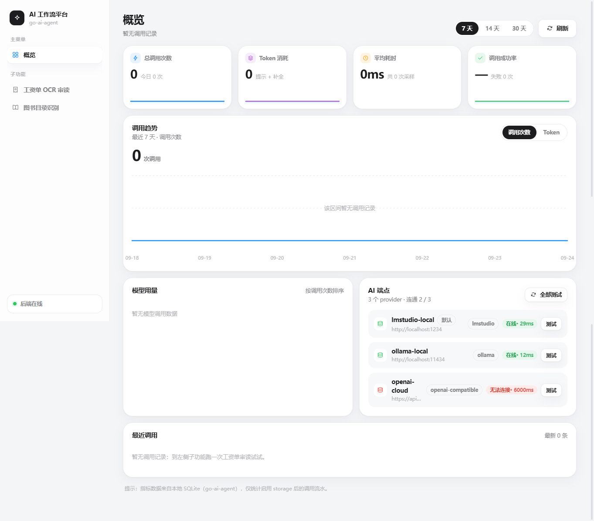
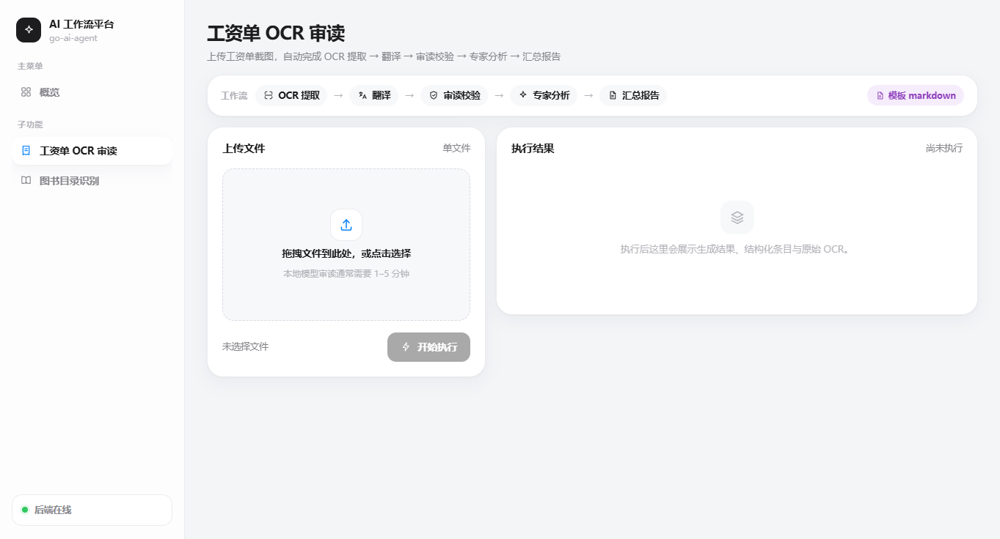
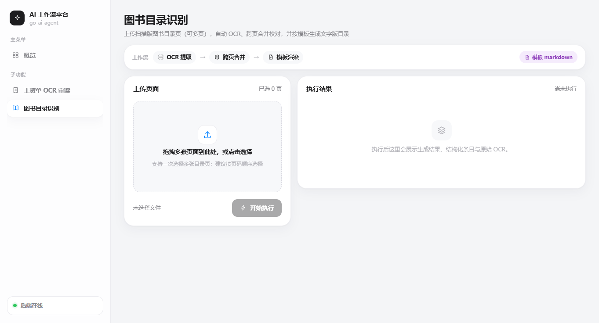

# 界面截图

Web UI 界面截图（`http://localhost:8000/`）。

## 概览仪表盘

调用量 / Token / 耗时 / 成功率指标卡、调用趋势图、模型用量、AI 端点连通性与最近调用。

## 工资单 OCR 审读

上传工资单截图，自动完成 OCR 提取 → 翻译 → 审读校验 → 专家分析 → 汇总报告。

## 图书目录识别

上传扫描版图书目录页（可多页），自动 OCR、跨页合并校对，并按模板生成文字版目录。

